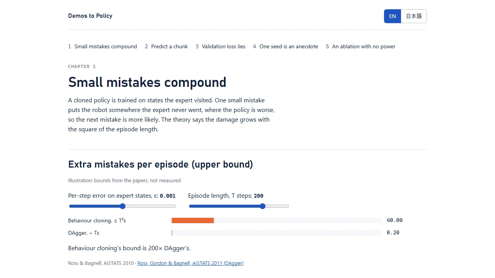

# Demos to Policy

Five questions about the numbers of imitation-learned robot policies, each answered with a measured result you can play with. **https://demos-to-policy.vercel.app**

- **Do small mistakes compound?** The behaviour-cloning vs DAgger bounds as an illustration, then the measured 0.05 vs 0.14.
- **Why predict a chunk of actions?** T/k decisions per episode, and the chunk policy under shifted physics.
- **Can validation loss lie?** A single-step policy with 3.6x lower loss lifts the cube 0.05 of the time; a 20-action chunk policy, 0.77.
- **Is one seed enough?** Six training runs of one recipe land anywhere from 0.12 to 0.92.
- **Can an ablation prove nothing?** Three text encoders sit inside each other's spread at 3-14% success.

Measured in [so-arm100-il](https://github.com/AungKaung1928/so-arm100-il) and [so-arm100-vla](https://github.com/AungKaung1928/so-arm100-vla), a simulated SO-100 arm (no real arm). Bound formulas: Ross & Bagnell 2010; Ross, Gordon & Bagnell 2011 (arXiv 1011.0686). English and Japanese. MIT licence.
